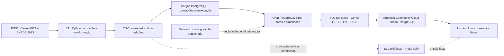

# Arquitetura do Observatório

O Censo é agregado por código de curso nas dimensões 1 e 2. A normalização textual da chave do ENADE permite a junção mesmo quando o legado armazena o código como VARCHAR. O recorte conserva os cursos sem ENADE. O Streamlit e o verificador usam a consulta compartilhada `sql/cursos.sql` em modo de leitura. A consulta usa diretamente as seis tabelas PostgreSQL. As dimensões informam instituição, curso, Cine e localização. A UF exibida corresponde à oferta presencial. EaD aparece em categoria própria.

O serviço Aiven existente e as contagens reais foram informados pela equipe. A seta PostgreSQL–dashboard descreve a conexão prevista para o Streamlit Community Cloud. A consulta e o painel foram validados localmente e a conexão hospedada ainda precisa de homologação. A configuração Terraform foi validada localmente. A existência do serviço, por si só, não identifica como ele foi provisionado.

**Acervo histórico.** Os DOCX registram uma etapa anterior com 1.665 cursos e descrevem filtros ou caminhos antigos. Para reprodução, use este diagrama, o dicionário atualizado e os guias Markdown. [Arquitetura histórica](Arquitetura.docx) · [Dicionário histórico](Dicionario.docx) · [Dicionário atual](dicionario_variaveis.md)
